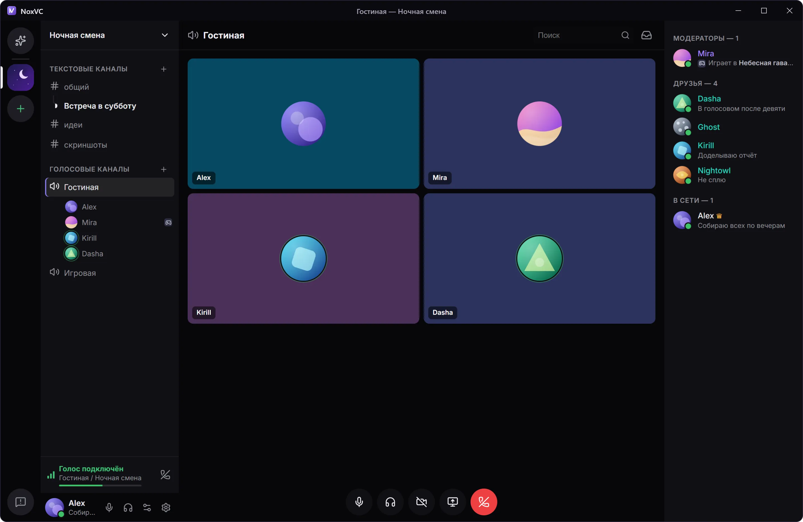
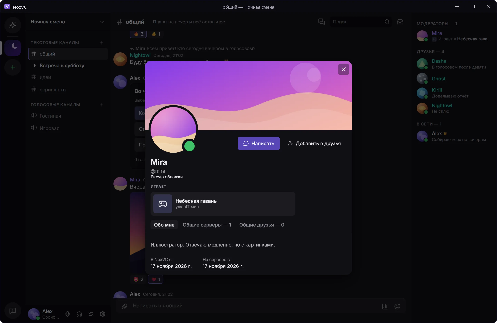
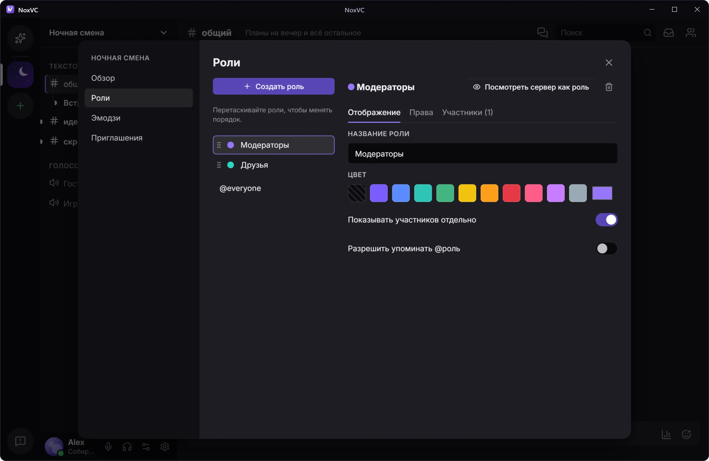
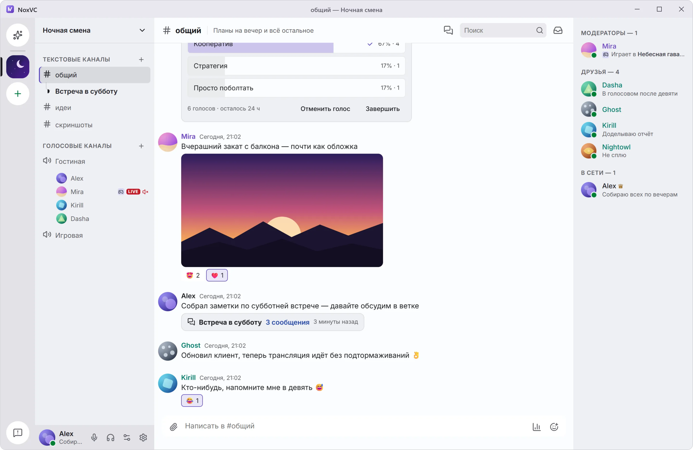

<p align="center">
  <picture>
    <source media="(prefers-color-scheme: light)" srcset="brand/out/noxvc-logo-on-light.svg">
    
  </picture>
</p>

<h3 align="center">Your voice. Your server. Your rules.</h3>

<p align="center">Self-hosted, open-source Discord alternative built with Rust, Tauri and LiveKit.</p>

<p align="center">
  <a href="LICENSE"></a>
  <a href="https://github.com/n1str/noxvc/releases/latest"></a>
  <a href="https://github.com/n1str/noxvc/actions/workflows/ci.yml"></a>
</p>

<p align="center"></p>

## Quick start

Requires Docker with Compose v2. Runs on `localhost` with development secrets:

```sh
git clone https://github.com/n1str/noxvc.git && cd noxvc/deploy
cp .env.example .env
docker compose up -d --build
docker compose exec relay /app/relay admin invite create --note "first admin"
```

Open <http://localhost:8080>, choose **Register with a code**, paste the code from the last command and register as
`admin` — the username listed in `INSTANCE_ADMINS` in `.env`, so this account becomes the instance administrator.
Voice works on `localhost` out of the box; for other machines put it behind a domain with HTTPS
([installation](docs/installation.md), [deployment](docs/deployment.md)).

**Windows app:** download the installer from [Releases](https://github.com/n1str/noxvc/releases) — on first start it
asks for your server address (HTTPS). To ship signed auto-updates to your users, build the client yourself
([desktop-client.md](docs/desktop-client.md)).

## Features

**Voice, video and screen sharing**
- Voice channels on LiveKit (WebRTC, Opus): noise suppression and echo cancellation, voice activity gate with
  adjustable threshold, push-to-talk, per-user volume, speaking indicators.
- Cameras and screen sharing with audio — a window or the whole screen. The Windows app captures natively
  (Windows Graphics Capture + hardware H.264) and can mute the stream's audio separately.
- Built-in TURN for clients behind strict NAT; private calls in direct messages; stage channels.

**Text**
- Channels, categories, replies, threads and forums, polls, reactions, custom emoji, mentions, markdown with
  code highlighting, attachments, link previews, pins, full-text search, unread markers.

**Roles and permissions**
- Discord-style roles: hierarchy, colors, permission overwrites on categories and channels, "view server as role".

**Profiles**
- Avatars and banners (animated GIF/WebP/video supported), profile color, status, bio, game activity
  (detected by the Windows app), light and dark theme, Russian and English UI.

**Invite-only by design**
- No open registration: accounts are created only with single-use invite codes (≈119 bits, stored hashed).
- Members can request an invite for someone; the instance admin approves or rejects it in the app.
- Admin panel: invite requests, codes, history, a bug-report/feature-request backlog, session and security log.
- CLI on the server: `relay admin invite create|list|revoke`, `relay admin requests list`.

**Windows client (Tauri 2)**
- Global hotkeys that work over games (Raw Input, nothing is intercepted), push-to-talk, tray, autostart,
  signed auto-updates, native screen capture.

**Operations**
- One `docker compose` file: server, PostgreSQL, S3 storage (Garage), LiveKit; optional Caddy (Let's Encrypt) and
  monitoring (Prometheus, Grafana dashboards, PostgreSQL and node exporters, alert rules).

**Lightweight.** Measured with 10 users in one voice channel, all transmitting audio at the same time, plus a chat
message every second: the NoxVC server used ~0.3% CPU and 147 MB RAM, LiveKit ~0.24 of one CPU core and 96 MB,
PostgreSQL ~2% CPU and 64 MB, Garage 13 MB — about 320 MB of RAM in total. Conditions: Docker Desktop (WSL2) on a
4-vCPU / 8 GB machine, `docker stats` sampled over ~25 s; media traffic was local, so this excludes network limits.

## Screenshots

| Chat | Voice channel |
|---|---|
|  |  |
| **Screen sharing** | **Profile** |
|  |  |
| **Roles** | **Light theme** |
|  |  |

All screenshots come from a demo instance with made-up users and data (`tests/demo`).

## Architecture

```
 Browser / Windows app (Tauri: WebView2 + native capture, hotkeys)
        │  HTTPS: web client, REST /api, WebSocket /gateway        │  WebRTC media (UDP 7882 / TCP 7881 / TURN 3478)
        ▼                                                           ▼
   Caddy (TLS) ──► NoxVC server (Rust, axum) ──── webhooks ────► LiveKit SFU (+ TURN)
                      │            │
                PostgreSQL     Garage (S3): attachments, avatars, emoji
```

The server is a single Rust binary: REST API, a Discord-style gateway (sequence numbers, RESUME), permission engine,
search, media processing queue (ffmpeg), invite-only registration and Prometheus metrics. It issues LiveKit tokens and
tracks voice presence through LiveKit webhooks. Details: [docs/architecture.md](docs/architecture.md).

## Requirements

- Linux server (x86_64) with Docker. Running needs little (about 320 MB RAM for 10 people in voice, see the measurement
  above); building the image compiles Rust and needs about 4 GB RAM — build on another machine if the server is smaller.
- A domain with two names (e.g. `app.example.com`, `voice.example.com`) for HTTPS.
- Open ports: TCP 80, 443 (HTTPS), TCP 7881 and UDP 7882 (media), UDP 3478 (TURN).
- Windows 10/11 for the desktop app (any modern browser for the web client).

## Documentation

[Installation](docs/installation.md) · [Configuration](docs/configuration.md) · [Deployment](docs/deployment.md) ·
[Desktop client](docs/desktop-client.md) · [Administration](docs/administration.md) · [Monitoring](docs/monitoring.md) ·
[Backup](docs/backup.md) · [Architecture](docs/architecture.md) · [Decisions](docs/decisions/)

## Roadmap

Not done yet — contributions welcome:
- macOS and Linux desktop clients, mobile apps (the web client works in mobile browsers, but is not optimized for them);
- end-to-end encryption (media and messages are encrypted in transit only, the server can read them);
- federation between servers;
- email (account recovery, notifications) and two-factor authentication;
- a signed Windows installer (SmartScreen warns about unsigned installers);
- Content-Security-Policy enabled by default (see [SECURITY.md](SECURITY.md)).

## How it was built

NoxVC was developed with an AI coding agent (Claude Code): the author set the requirements, reviewed the changes and
tested them by hand; the agent wrote most of the code together with API, end-to-end and unit tests. Expect the code
comments to be in Russian.

## Contributing

See [CONTRIBUTING.md](CONTRIBUTING.md). Security issues: [SECURITY.md](SECURITY.md).

## License

[AGPL-3.0](LICENSE) © n1str. If you run a modified version as a network service, you must offer its source code to
its users.

---

## По-русски

**NoxVC** — самостоятельно разворачиваемая альтернатива Discord с открытым кодом: голосовые каналы, видео,
демонстрация экрана со звуком, текстовые каналы с ветками и опросами, роли и права, приложение для Windows.
Регистрация — только по приглашениям. Быстрый старт — выше (четыре команды), подробности — в [docs/](docs/).
Интерфейс на русском и английском. Лицензия AGPL-3.0.
