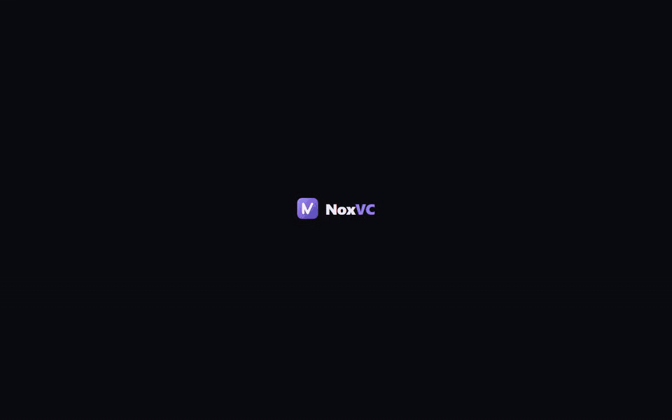
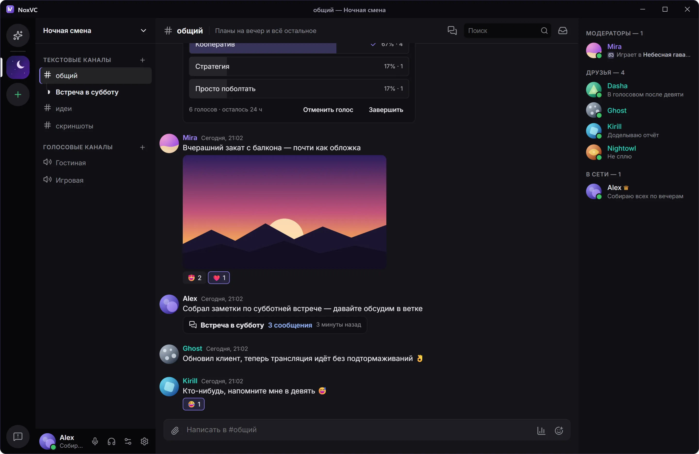
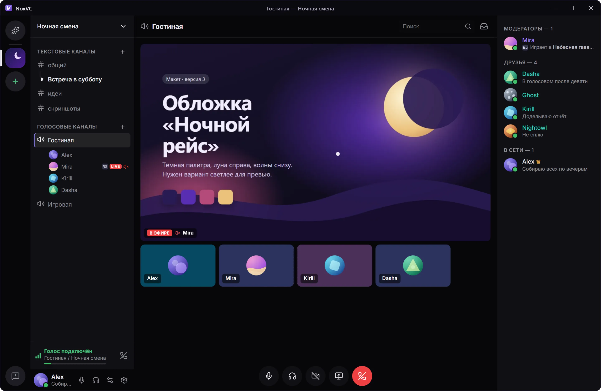

<p align="center">
  <picture>
    <source media="(prefers-color-scheme: light)" srcset="brand/out/noxvc-logo-on-light.svg">
    
  </picture>
</p>

<h3 align="center">Твой голос. Твой сервер. Твои правила.</h3>

<p align="center">Самостоятельно разворачиваемая альтернатива Discord с открытым кодом на Rust, Tauri и LiveKit.</p>

<p align="center"><b>Русский</b> · <a href="README.en.md">English</a></p>

<p align="center">
  <a href="LICENSE"></a>
  <a href="https://github.com/n1str/noxvc/releases/latest"></a>
  <a href="https://github.com/n1str/noxvc/actions/workflows/ci.yml"></a>
</p>

<p align="center"></p>

## Быстрый старт

**На сервере (VDS)** — Linux с публичным IP и двумя DNS-именами (например, `app.example.com` и `voice.example.com`):

```sh
git clone https://github.com/n1str/noxvc.git && cd noxvc && sudo ./install.sh
```

Скрипт спросит домен и логин администратора, сгенерирует секреты, запустит всё в Docker с HTTPS (Let's Encrypt) и
сам создаст аккаунт администратора — в конце покажет логин и пароль. Подробно, по шагам:
[docs/installation.md](docs/installation.md).

**На своём компьютере** (нужен Docker с Compose v2):

```sh
git clone https://github.com/n1str/noxvc.git && cd noxvc/deploy
cp .env.example .env
docker compose up -d --build
```

Откройте <http://localhost:8080> и зарегистрируйтесь с логином `admin` — он указан в `INSTANCE_ADMINS` и станет
администратором.

**Приложение для Windows:** установщик — в [Releases](https://github.com/n1str/noxvc/releases); при первом запуске оно
спросит адрес вашего сервера (HTTPS). Чтобы раздавать пользователям подписанные автообновления, соберите клиент сами
([docs/desktop-client.md](docs/desktop-client.md)).

## Возможности

**Голос, видео и демонстрация экрана**
- Голосовые каналы на LiveKit (WebRTC, Opus): шумоподавление и эхоподавление, порог голоса, рация (push-to-talk),
  громкость каждого участника, индикаторы речи.
- Камеры и демонстрация экрана со звуком — окно или весь экран. Приложение для Windows захватывает экран нативно
  (Windows Graphics Capture + аппаратный H.264) и умеет выключать звук трансляции отдельно.
- Встроенный TURN для клиентов за строгим NAT; звонки в личных сообщениях; каналы-сцены.

**Текст**
- Каналы и категории, ответы, ветки и форумы, опросы, реакции, свои эмодзи, упоминания, markdown с подсветкой кода,
  вложения, превью ссылок, закрепы, полнотекстовый поиск, непрочитанное.

**Роли и права**
- Роли как в Discord: иерархия, цвета, переопределения прав на категории и каналы, «посмотреть сервер как роль».

**Профили**
- Аватары и баннеры (в том числе анимированные GIF/WebP/видео), цвет профиля, статус, «о себе», игровая активность
  (определяет приложение для Windows), светлая и тёмная тема, интерфейс на русском и английском.

**Администрирование**
- Администраторы инстанса задаются в конфиге сервера; панель обращений (баги и предложения пользователей).
- Необязательный режим «только по приглашениям» (`REGISTRATION=invite`): одноразовые коды, запросы участников
  с одобрением администратора, CLI `relay admin invite …`.
- Список сеансов и журнал безопасности у каждого пользователя.

**Приложение для Windows (Tauri 2)**
- Глобальные горячие клавиши поверх игр (Raw Input, нажатия не перехватываются), рация, трей, автозапуск,
  подписанные автообновления, нативный захват экрана.

**Эксплуатация**
- Один файл `docker compose`: сервер, PostgreSQL, S3-хранилище (Garage), LiveKit; по желанию — Caddy (Let's Encrypt)
  и мониторинг (Prometheus, дашборды Grafana, экспортеры PostgreSQL и сервера, правила алертов).

**Нетребовательность.** Замер: 10 человек в одном голосовом канале, все одновременно передают звук, плюс сообщение в
чат каждую секунду. Сервер NoxVC — около 0,3 % CPU и 147 МБ памяти, LiveKit — около 0,24 ядра и 96 МБ, PostgreSQL —
около 2 % CPU и 64 МБ, Garage — 13 МБ; всего около 320 МБ памяти. Условия: Docker Desktop (WSL2), 4 vCPU / 8 ГБ,
`docker stats` около 25 секунд; медиа шло локально, сетевые ограничения не учитываются.

## Скриншоты

| Чат | Голосовой канал |
|---|---|
|  |  |
| **Демонстрация экрана** | **Профиль** |
|  |  |
| **Роли** | **Светлая тема** |
|  |  |

Все скриншоты сняты на демо-стенде с выдуманными пользователями и данными (`tests/demo`).

## Как устроено

```
 Браузер / приложение для Windows (Tauri: WebView2 + нативный захват, горячие клавиши)
        │  HTTPS: веб-клиент, REST /api, WebSocket /gateway        │  медиа WebRTC (UDP 7882 / TCP 7881 / TURN 3478)
        ▼                                                           ▼
   Caddy (TLS) ──► сервер NoxVC (Rust, axum) ──── вебхуки ────► LiveKit SFU (+ TURN)
                      │            │
                PostgreSQL     Garage (S3): вложения, аватары, эмодзи
```

Сервер — один бинарник на Rust: REST API, gateway в стиле Discord (номера событий, RESUME), движок прав, поиск,
очередь обработки медиа (ffmpeg), регистрация (открытая или по приглашениям) и метрики Prometheus. Он выдаёт токены
LiveKit и узнаёт, кто в голосе, по вебхукам LiveKit. Подробнее: [docs/architecture.md](docs/architecture.md).

## Требования

- Сервер на Linux (x86_64) с Docker. Для работы нужно немного (около 320 МБ памяти на 10 человек в голосе, см. замер
  выше); сборка образа компилирует Rust и требует около 4 ГБ памяти.
- Домен с двумя именами (например, `app.example.com` и `voice.example.com`) для HTTPS.
- Открытые порты: TCP 80, 443 (HTTPS), TCP 7881 и UDP 7882 (медиа), UDP 3478 (TURN).
- Windows 10/11 для приложения; веб-клиент работает в любом современном браузере.

## Документация

[Установка](docs/installation.md) · [Настройки](docs/configuration.md) · [Развёртывание](docs/deployment.md) ·
[Приложение для Windows](docs/desktop-client.md) · [Администрирование](docs/administration.md) ·
[Мониторинг](docs/monitoring.md) · [Резервные копии](docs/backup.md) · [Архитектура](docs/architecture.md) ·
[Решения](docs/decisions/) · English: [docs/en/](docs/en/)

## Что ещё не сделано

- Клиенты для macOS и Linux, мобильные приложения (веб-клиент открывается в мобильном браузере, но под него не
  оптимизирован);
- сквозное шифрование (сообщения и медиа шифруются только при передаче, сервер может их прочитать);
- федерация между серверами;
- почта (восстановление доступа, уведомления) и двухфакторная аутентификация;
- подписанный установщик для Windows (SmartScreen предупреждает о неподписанных);
- Content-Security-Policy по умолчанию (см. [SECURITY.md](SECURITY.md)).

## Как сделан

При разработке использовались инструменты ИИ. Комментарии в коде в основном на русском.

## Участие в разработке

См. [CONTRIBUTING.md](CONTRIBUTING.md). Уязвимости: [SECURITY.md](SECURITY.md).

## Лицензия

[AGPL-3.0](LICENSE) © n1str. Если вы запускаете изменённую версию как сетевой сервис, вы обязаны предоставить её
исходный код пользователям.
